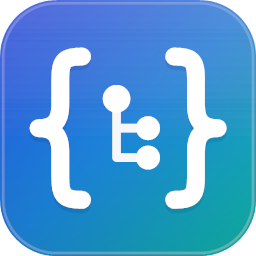
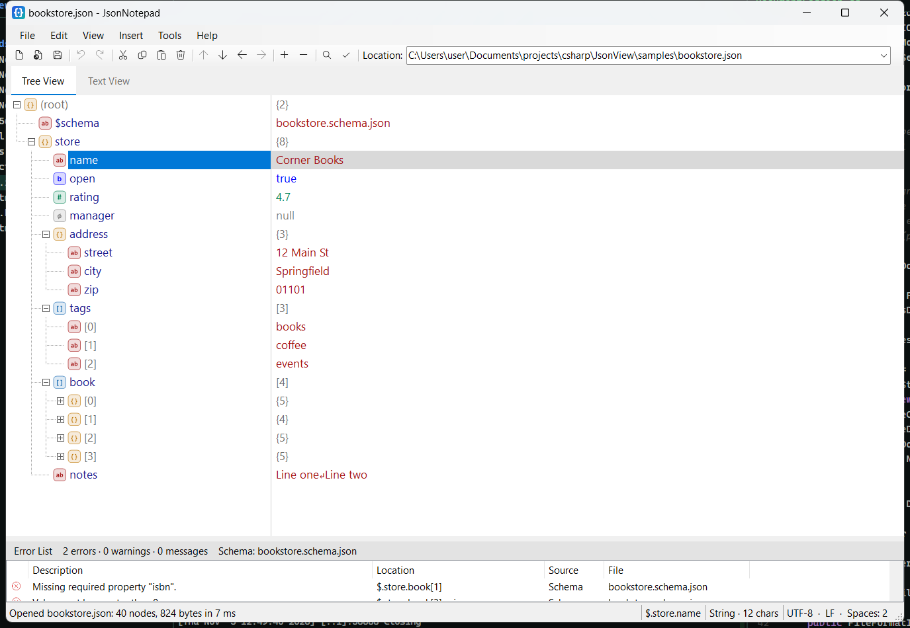

<p align="center">
  
</p>

<h1 align="center">JsonNotepad</h1>

<p align="center">
  A fast, tree-based viewer and editor for JSON files on Windows, inspired by Microsoft's
  <a href="https://github.com/microsoft/XmlNotepad">XML Notepad</a>.<br/>
  Built with C# / .NET 9 WinForms. No third-party packages.
</p>



## Why

Editing a large JSON file in a text editor means counting brackets and hunting for commas. JsonNotepad shows the document the way XML Notepad shows XML: a tree of names on the left and values on the right, with in-place editing, undo, and drag-and-drop restructuring. It stays responsive on files of hundreds of megabytes.

## Features

**Viewing**
- Two-column tree: names on the left, values on the right, with type badges, dotted tree lines and a draggable divider
- Virtualized rendering: millions of values scroll smoothly
- Text View: syntax-highlighted, pretty-printed text, virtualized for very large documents. Double-click a line to jump to its node in the tree
- Status bar with the JSONPath of the selection, type and size, plus encoding, line endings and indentation
- Light and dark themes (Options ▸ Theme)

**Editing**
- In-place editing of names and values
  - Enter edits, Esc cancels, Ctrl+Enter adds a line break inside a string
  - Numbers and booleans are validated as you type
- Insert ▸ Object / Array / String / Number / Boolean / Null ▸ Before / After / Child
- **Change To**: convert between types while keeping content (stringify and parse embedded JSON, object ⇄ array)
- Nudge Up/Down/Left/Right (Ctrl+Shift+arrows) and drag and drop (Ctrl to copy)
- Cut / Copy / Paste of subtrees as JSON text, including `"key": value` fragments
- Duplicate, Sort Properties (optionally recursive), Edit as JSON (Ctrl+E)
- Unlimited-feeling undo/redo with compound steps (Replace All is one undo)

**Finding and navigating**
- Find / Replace (Ctrl+F / Ctrl+H): match case, whole word, regex, names and/or values
- Type-to-find in the tree, Go to Path (Ctrl+G), Copy Path (Ctrl+Shift+C)

**Validating**
- JSON Schema validation (drafts 4–2020-12 core vocabulary, local `$ref`), runs in the background while you edit
- Uses Tools ▸ Assign Schema, or a root `"$schema"` pointing to a local file
- Duplicate-key warnings
- Error list with click-to-navigate and F4 for the next error

**Files**
- Detects encoding (UTF-8/16/32, with or without BOM), indentation and line endings, and preserves them on save
- Output Format: Preserve / Indented / Compact (minified)
- Accepts comments and trailing commas (JSONC); both are configurable
- Crash-safe atomic saves, reload prompt when the file changes on disk, recent files, a location bar, drag files onto the window
- Statistics: counts per type, depth, largest containers and most frequent keys

## Getting started

### Install

| Option | How |
|---|---|
| Microsoft Store | *coming soon* |
| Installer | [JsonNotepad-setup.exe](https://github.com/ismailian/JsonNotepad/releases/latest/download/JsonNotepad-setup.exe) (needs the [.NET 9 Desktop Runtime](https://dotnet.microsoft.com/download/dotnet/9.0)) or [JsonNotepad-setup-standalone.exe](https://github.com/ismailian/JsonNotepad/releases/latest/download/JsonNotepad-setup-standalone.exe) (includes .NET) |
| Portable | [JsonNotepad-portable.zip](https://github.com/ismailian/JsonNotepad/releases/latest/download/JsonNotepad-portable.zip), unzip and run (needs the .NET 9 Desktop Runtime) |
| All releases | [GitHub Releases](https://github.com/ismailian/JsonNotepad/releases) |
| Build from source | Requires the [.NET 9 SDK](https://dotnet.microsoft.com/download) |

```powershell
git clone https://github.com/ismailian/JsonNotepad.git
cd JsonNotepad
dotnet build -c Release
dotnet run --project src/JsonNotepad.App -c Release -- samples/bookstore.json
```

`samples/bookstore.json` references `bookstore.schema.json` through `$schema`, so it opens with live validation errors you can try fixing.

### Run the tests

```powershell
dotnet run --project tests/JsonNotepad.Core.Tests -c Release                    # all tests
dotnet run --project tests/JsonNotepad.Core.Tests -c Release -- --exclude-category perf
dotnet run --project tests/JsonNotepad.Core.Tests -c Release -- Undo            # filter by name
```

### Build scripts

| Script | Purpose |
|---|---|
| `build/build.ps1` | Restore, build and test |
| `build/package-msix.ps1 -Bundle` | x64 + arm64 `.msixbundle` for the Store |
| `build/package-msix.ps1 -CreateDevCertificate` | Signed package for sideloading |
| `build/package-inno.ps1` | Classic setup.exe (requires Inno Setup); `-FrameworkDependent` for the small variant |
| `build/package-release.ps1` | Stage all GitHub release assets (stable names) + checksums + release notes |
| `build/package-site.ps1` | Copy the small downloads into `site/downloads` for Cloudflare Pages |
| `build/version.ps1 minor` | Bump the version |
| `build/generate-icons.ps1` | Regenerate the icon and Store assets |

## Keyboard shortcuts (selection)

| Action | Keys |
|---|---|
| Edit value / rename | Enter / F2 |
| Insert sibling / child | Ctrl+Enter / Ctrl+Shift+Enter |
| Nudge node | Ctrl+Shift+↑ ↓ ← → |
| Expand / collapse | → / ←, Num + / Num −, Num * (subtree) |
| Switch name/value column | Tab |
| Tree / Text / Error list | Ctrl+1 / Ctrl+2 / Ctrl+3 |
| Validate / next error | F5 / F4 |
| Find / next / previous | Ctrl+F / F3 / Shift+F3 |
| All shortcuts | F1 |

## Architecture in one picture

```
JsonNotepad.App (WinForms shell: MainForm, dialogs, settings, ActionRegistry)
   │
   ├── JsonNotepad.Controls (owner-drawn, virtualized: JsonTreeView, JsonTextView, ErrorListView, themes)
   │
   └── JsonNotepad.Core (net9.0, no UI: model, streaming parser, writer, undo/redo,
                      JSONPath, find/replace, JSON Schema, background services)
```

Design patterns: Command + Composite (undo), Facade (`NodeEditor`, `DocumentSession`), Observer (model events), Builder (parser), Flyweight (name table), Strategy (find, conversions) and snapshot-based background processing. Read more:

| Document | Contents |
|---|---|
| [docs/architecture.md](docs/architecture.md) | Layers, types, threading model, patterns |
| [docs/xmlnotepad-analysis.md](docs/xmlnotepad-analysis.md) | What we learned from XML Notepad's source and how each idea was adapted |
| [docs/performance.md](docs/performance.md) | Large-file techniques and measurements |
| [docs/packaging.md](docs/packaging.md) | Versioning, MSIX, Microsoft Store, Inno Setup, release checklist |

## Contributing

Issues and pull requests are welcome. Please read [CLAUDE.md](CLAUDE.md); it doubles as the contributor guide for conventions (no NuGet packages, Core stays UI-free, every edit goes through a command, background work uses snapshots). Run the test suite before submitting.

## Acknowledgements

JsonNotepad's design is modeled on [XML Notepad](https://github.com/microsoft/XmlNotepad) by Microsoft (MIT License). No XML Notepad code is included; see [the analysis](docs/xmlnotepad-analysis.md) for what was learned from it.

## License

[MIT](LICENSE)
